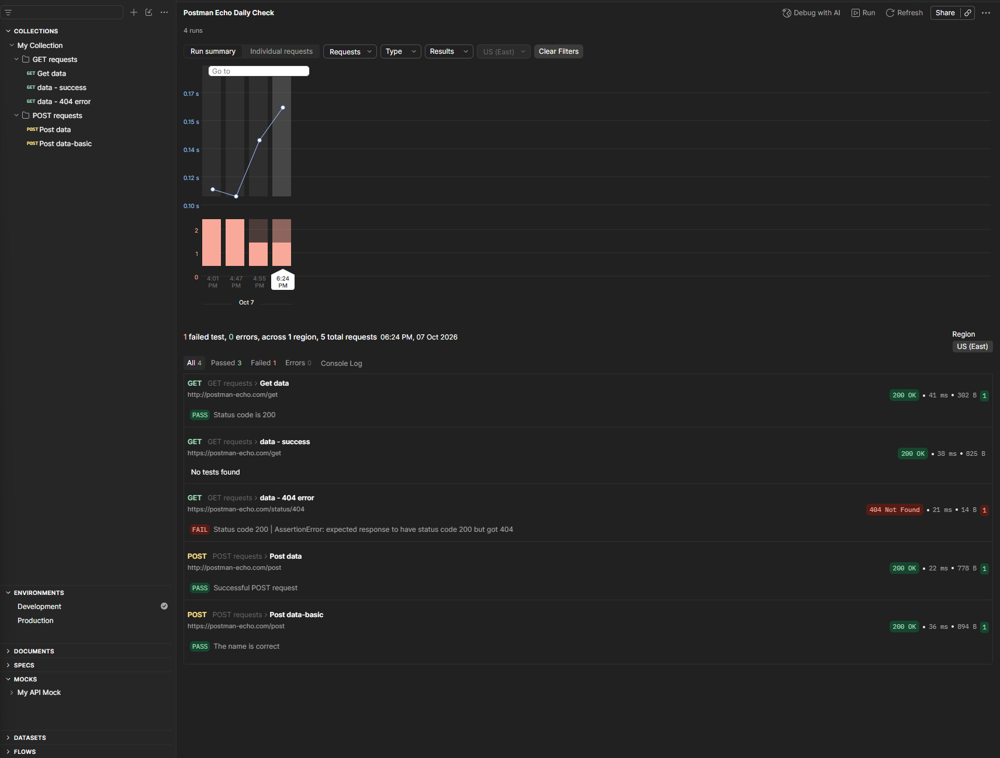

# Postman API Testing

API testing project built with Postman and Newman.

## What's Inside
- A request collection split into GET and POST requests
- Automated tests (status code and response data checks)
- A configured environment with a `baseUrl` variable
- Test scenarios for successful and failed server responses (200, 404)
- A Mock Server with three manually created endpoints

## Files
- `My Collection.postman_collection.json` – the request collection
- `Development.postman_environment.json` – the environment with the variable

## How to Run

### In Postman
1. Import both files via **File → Import**
2. Select the **Development** environment in the top-right corner
3. Open any request and click **Send**

### With Newman (Terminal)
Requires Node.js and Newman (`npm install -g newman`)

`newman run "My Collection.postman_collection.json" -e "Development.postman_environment.json"`

## Mock Server
Explored the Mock Server feature in Postman: creating a fake API server to test endpoints before the real backend is ready.

Endpoints:
- `GET /health` – server health check
- `GET /hello` – a test greeting response
- `GET /products` – a list of products in JSON format

Example `/products` response:

    [
      { "name": "Coat", "price": 200 },
      { "name": "Gloves", "price": 70 },
      { "name": "Shawl", "price": 70 }
    ]

All endpoints were tested manually and returned 200 OK.

## CI/CD
Automated checks run with GitHub Actions (`.github/workflows/tests.yml`): Newman runs the tests on every push.

One test (`data - 404 error`) intentionally fails. It shows what an `AssertionError` looks like when the expected and actual status codes don't match, and is used to practice reading and analyzing failed test reports.

## Monitoring
Set up a Postman Monitor to run the collection daily in the Postman cloud and send an email alert on failures. The monitor is currently paused to save free-plan usage.

While setting it up, I found that requests using `{{baseUrl}}` failed only in the monitor. The cause: the variable had only a local value, while cloud runs use shared values. After sharing the value, I re-ran the monitor and confirmed that the requests passed.

## Tech Stack
Postman, Newman, JavaScript, GitHub Actions
